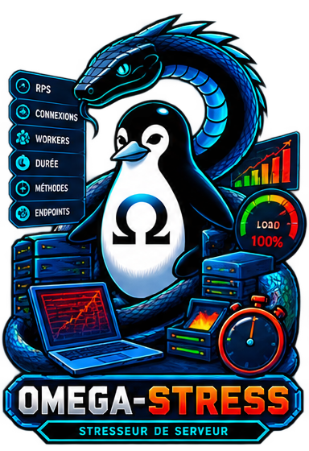

<!-- Copyright (c) 2026 kraynux - kraynux@proton.me - Лицензия MIT (см. файл LICENSE) -->
<div align="center">
  
</div>

# 🗲 OMEGA-STRESS

**Рабочее место для контролируемого нагрузочного тестирования HTTP**

> Создано **kraynux** для **Omega-server** 
[https://kraynux.snake-mackarel.ts.net](https://kraynux.snake-mackarel.ts.net)

Официальная страница: [OMEGA-STRESS](https://kraynux.snake-mackarel.ts.net/omega-stress/) &nbsp; Скриншоты: [Screenshots](https://kraynux.snake-mackarel.ts.net/omega-stress/screenshots/)  

[](../../../LICENSE)
[](https://www.python.org/)
[](https://www.linux.org/)
[](https://github.com/Textualize/rich)

🌐 Интерфейс и экспортируемые отчёты доступны на **17 языках** — см. [Языки интерфейса](#языки-интерфейса).  
**Языки:**  
 [Français](../../../README.md) ·  [English](../en/README.md) ·  [Español](../es/README.md) ·  [Português (Brasil)](../pt-BR/README.md) ·  [Italiano](../it/README.md) ·  [Deutsch](../de/README.md) ·  [Nederlands](../nl/README.md) ·  [Polski](../pl/README.md) ·  [Русский](README.md) ·  [中文](../zh-CN/README.md) ·  [Tiếng Việt](../vi/README.md) ·  [ไทย](../th/README.md) ·  [Bahasa Indonesia](../id/README.md) ·  [日本語](../ja/README.md) ·  [한국어](../ko/README.md) ·  [हिन्दी](../hi/README.md) ·  [العربية](../ar/README.md)


**Omega-Stress** — локальное терминальное приложение (TUI на [Textual](https://github.com/Textualize/textual) + CLI для сценариев), которое проводит нагрузочные тесты HTTP контролируемо и воспроизводимо: замороженные профили, история, повторный запуск, подробный экспорт (JSON/CSV/HTML), явные пределы безопасности.

Проект построен по принципам **Clean Architecture**, с чётким разделением предметной области, оркестрации, инфраструктуры и пользовательского интерфейса.
---

## Содержание

- [Обзор](#обзор)
- [Возможности](#возможности)
- [Архитектура](#архитектура)
- [Требования](#требования)
- [Установка](#установка)
- [Использование](#запуск)
- [Профили длительности D1-D6](#профили-длительности-d1-d6-режим-профиля)
- [Режим безопасности](#режим-безопасности)
- [Локальная калибровка](#локальная-калибровка)
- [Настройка](#настройка)
- [Тесты и качество](#тесты-и-качество)
- [Удаление](#удаление)
- [Известные ограничения](#известные-ограничения)
- [Лицензия](#лицензия)

## Обзор

### Цели

## Что делает Omega-Stress (цель V1)

- Три контролируемых семейства тестов: **Тест запросов** (пропускная способность), **Тест соединений** (одновременность), **Нагрузочный тест** (постепенный рост).
- **8 уровней интенсивности** (Слабый/Низкий/Средний/Высокий/Мощный/Агрессивный/Жёсткий/Максимум), с трёхступенчатой моделью предпроверки (никогда не требуется / требуется по желанию / требуется обязательно — см. [Значения тестов](#значения-тестов)).
- **Два режима длительности**: ручной (от 1 до 5 мин, с ограничением по уровню) или **именованный профиль D1-D6** (фиксированная общая длительность с разогревом/нарастанием/плато/спадом — см. [Профили длительности D1-D6](#профили-длительности-d1-d6-режим-профиля)).
- **Режим безопасности** (включён по умолчанию, отключается при каждом запуске): локальные ограничители CPU/памяти машины-хоста, отдельные от порогов, защищающих тестируемую цель, — см. [Режим безопасности](#режим-безопасности).
- **Сохраняемая локальная калибровка**: измеряет реальную производительность машины-хоста (никогда не цели) через локальный петлевой сервер, ступенями растущей нагрузки, — см. [Локальная калибровка](#локальная-калибровка).
- Замороженные, повторно используемые, записываемые в историю профили — **необязательные**: тест так же хорошо запускается в ручном режиме, вообще без профиля, прямым выбором или вводом цели.
- Обязательное явное подтверждение права на запуск для любой незакреплённой цели.
- Пороги автоматической остановки, никогда — неограниченная нагрузка.
- Подробный экспорт JSON/CSV/HTML (ступени, метрики по интервалам, вердикт, диагностика).
- Неинтерактивный режим CLI для автоматизации (cron, CI), вызывающий ровно те же сценарии использования, что и TUI.
- Автоматическая подстройка под терминал (тема + упрощаемый профиль отображения).

## Чего проект не делает

- Не заменяет инструмент сетевого сканирования — словарь и позиция продукта сознательно «нагрузочный тест», никогда «сканирование».
- Не содержит внешнего движка нагрузки (k6 и т. п.) — собственная генерация на `httpx`/asyncio.
- Никогда не начинает запуск без пределов и без подтверждения права.
- Не является распределённым инструментом нагрузки: генерация идёт на одной машине, в одном процессе, — см. [Известные ограничения](#известные-ограничения).

## Возможности

- **Три семейства тестов**, в каждом 8 уровней интенсивности (Слабый/Низкий/Средний/Высокий/Мощный/Агрессивный/Жёсткий/Максимум) — точные значения каждого уровня см. в таблице [Ориентиры нагрузки](#значения-тестов).
- **Замороженные профили тестов**: имя, цель, семейство, интенсивность, длительность, порог ошибок — создаются один раз и запускаются повторно без изменений из TUI или CLI.
- **Именованные профили длительности D1-D6** (режим «профиля»), альтернатива ручному режиму: фиксированная общая длительность (от 1 до 120 мин) с разогревом/нарастанием/плато/спадом, которая также ограничивает доступные уровни, — см. [Профили длительности D1-D6](#профили-длительности-d1-d6-режим-профиля).
- **Режим безопасности**, отмеченный по умолчанию на каждом экране запуска: останавливает тест, если машина-хост (не цель), похоже, в опасности. Его можно сознательно отключить; тогда появляется напоминание, сравнивающее выбранный уровень с последней калибровкой, — см. [Режим безопасности](#режим-безопасности).
- **Сохраняемая локальная калибровка**: измеряет, что машина действительно выдерживает (7 ступеней растущей нагрузки на встроенный локальный петлевой сервер), результат доступен на экране Калибровка, — см. [Локальная калибровка](#локальная-калибровка).
- **Закреплённые цели**: для закреплённого адреса не нужно заново отмечать право при каждом запуске; недавние незакреплённые цели остаются видимыми (не более 10) без неявного права. Закреплённую цель можно использовать двумя независимыми способами: напрямую, чтобы запустить тест в ручном режиме без профиля, или как цель по умолчанию при создании замороженного профиля.
- **Полная история**: каждый запуск записывается (вердикт, метрики, ход по интервалам, использованный режим безопасности); запуск, связанный с замороженным профилем, можно повторить без изменений.
- **Подробный экспорт** в JSON (сырые данные для повторного импорта), CSV (табличный анализ) или HTML (удобочитаемый отчёт с темой на выбор из 10 палитр проекта). HTML-отчёт пишется на языке, выбранном в Настройках («Язык экспорта», по умолчанию — язык интерфейса); JSON и CSV остаются данными и не переводятся.
- **Предпроверка**: автоматическая и обязательная перед любым тестом уровня Жёсткий/Максимум, необязательная (но открывающая бо́льшие длительности) на уровнях Мощный/Агрессивный, со сроком действия (24 ч).
- **Наблюдение в реальном времени** за идущим тестом: индикатор хода с надёжным обратным отсчётом (оставшееся время вычисляется напрямую, а не оценивается), пропускная способность/ошибки/задержка p95 обновляются на каждом интервале, ручная остановка возможна без выхода из приложения.
- **Единые настройки**: тема (10 палитр Omega + все встроенные темы Textual, всего 31 через палитру команд), режим отображения (автоматический или принудительный), папки экспорта и снимков экрана, очистка целей/истории.
- **Встроенная справка** (клавиша `a`): сочетания клавиш, описание каждого экрана (включая Калибровку и Режим безопасности), справочная таблица значений нагрузки и таблица профилей длительности D1-D6.
- **CLI для сценариев** (`omega-stress profile|run|history|export|calibrate ...`), ровно те же сценарии использования, что и в TUI, с выводом `--json` для автоматизации.
- **Автоматическая подстройка под терминал**: семейство и размер определяются при запуске, тема и богатство отображения подстраиваются соответственно (см. [Поддерживаемые терминалы](#поддерживаемые-терминалы)).

## Архитектура

Clean Architecture + Ports & Adapters в 9 пакетах (`app/`, `core/`, `domain/`, `application/`, `ports/`, `infrastructure/`, `interfaces/`, `plugins/`, `shared/`).
Все подробности: `ARCHITECTURE.md`.

```text
src/omega_stress/
├── app/              Запуск и контейнер внедрения зависимостей (ручное связывание, без DI-фреймворка)
├── core/             Общий словарь: перечисления, корневые исключения, Result/Ok/Err, возможности системы
├── domain/           Чистая предметная логика: нагрузка, профили, запуски, цели, темы, терминал — без ввода-вывода
├── application/      Оркестрация: commands (действия), queries (чтение), конвейер выполнения (guards/hooks)
├── ports/            Контракты Protocol/ABC, ожидаемые адаптерами (репозитории, экспортёры, генератор нагрузки...)
├── infrastructure/   Конкретные реализации: SQLite, экспортёры JSON/CSV/HTML, генератор httpx/asyncio, определение терминала, системный зонд
├── interfaces/       Два независимых адаптера представления: TUI (Textual) и CLI (argparse)
├── plugins/          Зарезервированная точка расширения (загрузка плагинов) — каркас есть, в V1 не реализован
└── shared/           Общие вспомогательные средства без предметных зависимостей (внедряемые часы, генерация идентификаторов)
```

### Принципы проектирования

- `domain/` не содержит ни ввода-вывода, ни зависимостей от инфраструктуры — чистая предметная логика, полностью проверяемая без моков.
- `application/` оркестрирует сценарии использования через домен и порты, никогда напрямую через конкретный класс из `infrastructure/`.
- `infrastructure/` реализует порты и никогда не импортируется напрямую из `application/` или `domain/` — на неё ссылаются только `interfaces/` и `app/`.
- `interfaces/` никогда не должен вызывать `infrastructure/` напрямую или `subprocess`: только через `application/` (commands/queries) и собственные контроллеры.
- `ports/` определяет контракты, ожидаемые адаптерами (Protocol), и никогда — реализацию.
- `core/` объединяет словарь, общий для всех слоёв, никогда не закладывая в него предметное правило с числами (пороги, длительности, пресеты — всегда в `domain/*/policies.py`).

Dependency Rule (только от внешних слоёв к внутренним) и изоляция сторонних технологий (`textual`, `sqlite3`, `httpx`, `jinja2`, каждая ограничена своей назначенной точкой входа) автоматически проверяются при каждом запуске `lint-imports` (см. [Тесты и качество](#тесты-и-качество)).

## Требования

- Python ≥ 3.10
- Для управления зависимостями рекомендуется [`uv`](https://github.com/astral-sh/uv) (иначе — обычный `pip`)

### Система

- Linux, в первую очередь Arch Linux и совместимые дистрибутивы.
- Python 3.10 или новее.
- Права root не нужны: Omega-Stress выполняет только исходящие HTTP-запросы от имени обычного пользователя.

## Установка

Официальный архив поставляется в формате `.tar.gz`. Перед установкой проверьте его целостность:

```bash
sha256sum omega-stress.tar.gz
```

### Способ 1 — сценарий установки

```bash
[ -d omega-stress ] && echo "ℹ️ Уже распаковано здесь, шаг пропущен." || tar -xzf omega-stress.tar.gz
[ -d ~/omega-stress ] && echo "ℹ️ ~/omega-stress уже существует, перемещение пропущено." || mv omega-stress ~/
cd ~/omega-stress/
chmod +x install.sh
./install.sh
```

### Способ 2 — полная устойчивая установка

Эту команду можно скопировать и вставить как есть и запускать повторно без ошибок: каждый шаг пропускает уже сделанное.

```bash
( [ -d omega-stress ] || tar -xzf omega-stress.tar.gz ) && \
( [ -d ~/omega-stress ] || mv omega-stress ~/ ) && \
cd ~/omega-stress && chmod +x install.sh && ./install.sh
```
`install.sh`:

1. Создаёт виртуальное окружение `.venv`, если его ещё нет.
2. Устанавливает зависимости (`pip install -e .`; `pyproject.toml` остаётся единственным источником истины).
3. Делает `omega-stress.sh` и `install.sh` исполняемыми.
4. Добавляет псевдоним `stress` в `~/.bashrc` и `~/.zshrc` (без дублирования, если он уже есть).

## Установка (для разработки)

```bash
uv sync --all-extras
# или без uv:
python -m venv .venv && source .venv/bin/activate
pip install -e ".[dev]"
```


### Запуск

```bash
cd ~/omega-stress
./omega-stress.sh

# или просто наберите "stress" в новом терминале, если псевдоним создан
```

Сценарий запуска:

1. Находит `.venv`, `venv` или системный Python.
2. Задаёт `PYTHONPATH` на `src/`.
3. Запускает `python -m omega_stress` — без аргумента открывает TUI; с аргументом передаёт управление CLI.

### Языки интерфейса

Интерфейс доступен на 17 языках: французском, английском, испанском, португальском (Бразилия), итальянском, немецком, нидерландском, польском, русском, упрощённом китайском, вьетнамском, тайском, индонезийском, японском, корейском, хинди и арабском. Язык выбирается в Настройках («Langue / Language») и применяется после перезапуска интерфейса; переменная `OMEGA_STRESS_LANG` (например, `OMEGA_STRESS_LANG=ru ./omega-stress.sh`) задаёт язык на один сеанс. При запуске из omega-suite omega-stress использует язык набора. В текстовой консоли Linux (TTY) языки с нелатинской письменностью на время сеанса показываются по-английски. Командная строка остаётся на французском.

### Использование CLI

```bash
omega-stress profile list                                     # список профилей
omega-stress profile create --name "Зондирование API" --target-id t-1 \
    --family request --level bas --duration-minutes 1 --max-error-rate 0.05
omega-stress profile freeze <profile-id>                       # заморозить профиль

# Обязательная предпроверка перед любым запуском уровня Жёсткий/Максимум (по желанию на Мощный/Агрессивный)
omega-stress run precheck --target-id t-1 --target-url https://exemple.org --confirm

omega-stress run request --target-id t-1 --target-url https://exemple.org \
    --level bas --duration-minutes 1 --max-error-rate 0.05 --confirm
omega-stress run connection --target-id t-1 --target-url https://exemple.org \
    --level moyen --duration-minutes 3 --max-error-rate 0.05 --confirm
omega-stress run ramp --target-id t-1 --target-url https://exemple.org \
    --level puissant --duration-minutes 3 --max-error-rate 0.05 --confirm --precheck-validated

# Режим профиля D1-D6 вместо --duration-minutes (взаимоисключающие)
# D4 (resilience) разрешает Агрессивный без условий, Жёсткий — с усиленным подтверждением
omega-stress run request --target-id t-1 --target-url https://exemple.org \
    --level violent --duration-preset d4 --max-error-rate 0.05 --confirm \
    --precheck-validated --confirmation-text JE_CONFIRME_LA_CIBLE_AUTORISEE

# --unsafe отключает режим безопасности (локальные ограничители CPU/памяти); по умолчанию не задан
omega-stress run connection --target-id t-1 --target-url https://exemple.org \
    --level violent --duration-minutes 1 --max-error-rate 0.05 --confirm \
    --precheck-validated --unsafe

omega-stress run replay <run-id> --confirm                     # повторяет запуск, связанный с замороженным профилем

omega-stress history list                                      # история запусков
omega-stress history show <run-id>                              # подробности запуска

omega-stress export <run-id> --format html --destination var/exports --theme omega-base

omega-stress calibrate run                                      # запускает калибровку этой машины
omega-stress calibrate show                                     # показывает последнюю известную калибровку
```

Значения `--level` (`faible`, `bas`, `moyen`, `haut`, `puissant`, `agressif`, `violent`, `maximum`) и текст подтверждения остаются на французском, как и вся командная строка.

`--confirm` — эквивалент флажка права в TUI для командной строки: обязателен для любой цели, ещё не закреплённой как разрешённая. Одинаковые `--target-id`/`--target-url` означают ручную (незакреплённую) цель; чтобы не указывать `--confirm` при каждом запуске, используйте идентификатор уже закреплённой цели.

Добавьте `--json` к `history`/`export`/`calibrate`, чтобы получить машиночитаемый вывод для cron/CI.

### Общий порядок работы

1. При первом запуске главный экран предлагает: Профили, Тест запросов, Тест соединений, Нагрузочный тест, История, Цели, Калибровка, Настройки, Справка.
2. На экране теста вверху по-прежнему можно выбрать замороженный профиль (необязательно): два способа задать цель и критерии, никогда не совмещаемые в одном запуске, —
   - **с профилем**: его выбор заполняет цель/интенсивность/длительность/порог ошибок, а поле ручной цели исчезает (оно теряет смысл); заполненные значения можно изменить перед запуском;
   - **без профиля (ручной режим)**: выбрать закреплённую/недавнюю цель из списка или ввести новую, отметить право, если цель ещё не закреплена как разрешённая, вручную задать интенсивность/длительность (ручную или профиль длительности D1-D6)/порог ошибок.

   В обоих случаях: оставить режим безопасности включённым или сознательно отключить его, выполнить предпроверку, если её требует уровень, и затем запустить тест.
3. Результат показывается сразу (вердикт, метрики, ход), без перехода в Историю — экспорт предлагается прямо на этом экране.
4. Профиль можно заморозить, чтобы позже без изменений повторить тот же тест — с экрана Профили или повтором из Истории.

### Значения тестов

8 уровней интенсивности, одинаковых в трёх семействах тестов (меняется только управляемый параметр), — полная таблица:

| Тип теста | Уровень | Управляемый параметр | Целевое значение | Предпроверка | Доступные длительности (ручной режим) |
|---|---|---|---|---|---|
| Тест запросов | Слабый | Пропускная способность | 250 запр./мин (≈4,2 запр./с) | Нет | от 1 до 5 мин |
| Тест запросов | Низкий | Пропускная способность | 500 запр./мин (≈8,3 запр./с) | Нет | от 1 до 5 мин |
| Тест запросов | Средний | Пропускная способность | 1000 запр./мин (≈16,7 запр./с) | Нет | от 1 до 5 мин |
| Тест запросов | Высокий | Пропускная способность | 2000 запр./мин (≈33,3 запр./с) | Нет | от 1 до 5 мин |
| Тест запросов | Мощный | Пропускная способность | 6000 запр./мин (≈100 запр./с) | По желанию | от 1 до 3 мин (5 при пройденной предпроверке) |
| Тест запросов | Агрессивный | Пропускная способность | 10 000 запр./мин (≈167 запр./с) | По желанию | от 1 до 3 мин (5 при пройденной предпроверке) |
| Тест запросов | Жёсткий | Пропускная способность | 15 000 запр./мин (≈250 запр./с) | **Обязательна** | Только от 1 до 3 мин |
| Тест запросов | Максимум | Пропускная способность | 20 000 запр./мин (≈333 запр./с) | **Обязательна** | Только от 1 до 3 мин |
| Тест соединений | Слабый | Одновременные соединения | 25 соединений | Нет | от 1 до 5 мин |
| Тест соединений | Низкий | Одновременные соединения | 50 соединений | Нет | от 1 до 5 мин |
| Тест соединений | Средний | Одновременные соединения | 100 соединений | Нет | от 1 до 5 мин |
| Тест соединений | Высокий | Одновременные соединения | 200 соединений | Нет | от 1 до 5 мин |
| Тест соединений | Мощный | Одновременные соединения | 1000 соединений | По желанию | от 1 до 3 мин (5 при пройденной предпроверке) |
| Тест соединений | Агрессивный | Одновременные соединения | 2000 соединений | По желанию | от 1 до 3 мин (5 при пройденной предпроверке) |
| Тест соединений | Жёсткий | Одновременные соединения | 3500 соединений | **Обязательна** | Только от 1 до 3 мин |
| Тест соединений | Максимум | Одновременные соединения | 5000 соединений | **Обязательна** | Только от 1 до 3 мин |
| Нагрузочный тест (постепенный рост) | Слабый | Пропускная способность, с нарастанием | пик 250 запр./мин | Нет | от 1 до 5 мин |
| Нагрузочный тест (постепенный рост) | Низкий | Пропускная способность, с нарастанием | пик 500 запр./мин | Нет | от 1 до 5 мин |
| Нагрузочный тест (постепенный рост) | Средний | Пропускная способность, с нарастанием | пик 1000 запр./мин | Нет | от 1 до 5 мин |
| Нагрузочный тест (постепенный рост) | Высокий | Пропускная способность, с нарастанием | пик 2000 запр./мин | Нет | от 1 до 5 мин |
| Нагрузочный тест (постепенный рост) | Мощный | Пропускная способность, с нарастанием | пик 6000 запр./мин | По желанию | от 1 до 3 мин (5 при пройденной предпроверке) |
| Нагрузочный тест (постепенный рост) | Агрессивный | Пропускная способность, с нарастанием | пик 10 000 запр./мин | По желанию | от 1 до 3 мин (5 при пройденной предпроверке) |
| Нагрузочный тест (постепенный рост) | Жёсткий | Пропускная способность, с нарастанием | пик 15 000 запр./мин | **Обязательна** | Только от 1 до 3 мин |
| Нагрузочный тест (постепенный рост) | Максимум | Пропускная способность, с нарастанием | пик 20 000 запр./мин | **Обязательна** | Только от 1 до 3 мин |

- **Предпроверка Нет**: тест запускается сразу, без условий по длительности.
- **Предпроверка По желанию** (Мощный/Агрессивный): тест запускается без предпроверки (длительность 1-3 мин), но пройденная предпроверка открывает ещё и длительности 4-5 мин.
- **Предпроверка Обязательна** (Жёсткий/Максимум): тест не запускается без заранее пройденной предпроверки; длительность и с предпроверкой ограничена 3 мин (здесь предпроверка определяет доступ к уровню, а не увеличенную длительность).

Столбец «Доступные длительности» выше относится только к **ручному режиму** (не более 5 мин). Сверх этого более длинные тесты (до 120 мин) позволяет только [режим профиля D1-D6](#профили-длительности-d1-d6-режим-профиля) — каждый профиль D1-D6 сам определяет, какие уровни остаются доступны при такой длительности (`free_max_level`/`reinforced_level`, см. его собственную таблицу):

| Уровень | Макс. длительность в ручном режиме | Макс. длительность через профиль D1-D6 |
|---|---|---|
| Слабый / Низкий / Средний / Высокий | 5 мин | 120 мин (D6, только Соединения/Нагрузка); 60 мин для Запросов (D5, D6 несовместим с этим семейством) |
| Мощный | 5 мин (3 мин без предпроверки) | 120 мин с усиленным подтверждением (D6, Соединения/Нагрузка) или 60 мин без него (D5) |
| Агрессивный | 5 мин (3 мин без предпроверки) | 60 мин с усиленным подтверждением (D5) или 30 мин без него (D4) |
| Жёсткий | 3 мин (предпроверка обязательна) | 30 мин с усиленным подтверждением (D4) или 15 мин без него (D3) |
| Максимум | 3 мин (предпроверка обязательна) | не более 5 мин (только D1/D2 — ни один профиль D3-D6 не предлагает Максимум, даже с подтверждением) |

Эта же таблица доступна прямо в приложении (Справка → Ориентиры нагрузки) и всегда строится из тех же опорных значений (`domain/load/presets.py`, `domain/load/policies.py`) — никогда не дублируется вручную.

> В Нагрузочном тесте в **ручном режиме** нарастание и плато автоматически масштабируются под выбранную длительность (с сохранением пропорций пресета): тест на 1 мин проходит всю кривую, от 0 до пика, а не только её начало. В **режиме профиля D1-D6** ту же гарантию изначально даёт разбивка каждого профиля на разогрев/нарастание/плато/спад — см. [Профили длительности D1-D6](#профили-длительности-d1-d6-режим-профиля).

### Навигация

- Стрелки вверх/вниз: перемещение курсора.
- `Tab` / `Shift+Tab`: переход между полями формы.
- `Esc`: назад (подтверждение выхода с главного экрана).
- `a`: показать справку.
- `t`: сменить тему.
- `q`: выйти (с подтверждением).
- `r`: обновляет отображение, полезно после изменения размера терминала.
- `Ctrl+P`: палитра команд (смена темы, снимок экрана, справка по сочетаниям клавиш).

Переключайте темы клавишей `t`: Omega-Stress автоматически подстраивает цвета и богатство отображения под обнаруженные возможности терминала на любом экране. В палитре команд (`Ctrl+P` → Тема) предлагаются все 31 доступная тема (10 тем Omega + 21 встроенная тема Textual).

### Поддерживаемые терминалы

Четыре режима отображения, от самого богатого до самого упрощённого: **Полный**, **Стандартный**, **Упрощённый**, **Моно**. Выбирается более строгий из двух — по определённому семейству терминала и по реальному размеру окна (никогда не богаче любого из двух пределов).

| Терминал | Режим по умолчанию |
|---|---|
| Ghostty, Alacritty, WezTerm, Kitty | Полный |
| Konsole, GNOME Terminal, Terminator, xfce4-terminal | Стандартный |
| urxvt, xterm | Упрощённый |
| TTY Linux | Моно |
| SSH (обнаружены true color/256 цветов) | Упрощённый |
| SSH (минимальный сигнал) | Моно |
| Нераспознанный терминал | Упрощённый (осторожный запасной вариант) |

При размере меньше 80 столбцов × 24 строки перед главным экраном появляется экран предупреждения (никогда не блокирующий: приложение остаётся пригодным в упрощённом режиме). Konsole, GNOME Terminal и Terminator распознаются по собственной характерной переменной окружения (`KONSOLE_VERSION`, `GNOME_TERMINAL_SCREEN`/`GNOME_TERMINAL_SERVICE`, `TERMINATOR_UUID`), а не по `TERM`, которую они оставляют с общим значением для совместимости, — xfce4-terminal пока не выставляет никакого известного аналогичного признака и потому получает тот же Стандартный режим только тогда, когда сообщает узнаваемое значение `TERM`/`TERM_PROGRAM`, иначе — Упрощённый.

### Внутренние и системные пути

По умолчанию Omega-Stress работает в собственной папке `var/`, относительно каталога, из которого он запущен (или в `$OMEGA_STRESS_VAR_DIR`, если она задана):

```text
var/db/app.db           # база SQLite (профили, цели, история)
var/settings.json       # сохранённые настройки (тема, режим отображения, папки по умолчанию)
var/exports/            # экспорт JSON/CSV/HTML по умолчанию
var/screenshots/        # снимки экрана SVG по умолчанию (палитра команд)
var/audit.jsonl         # журнал аудита (одна строка на запуск)
var/app.log             # журнал приложения
```

Абсолютный системный путь (например, `/var/exports/`) по умолчанию никогда не используется — начальный `/` поэтому важен: за пределы папки выходит только явный экспорт в папку, выбранную пользователем (Настройки или экран Экспорт).

## Профили длительности D1-D6 (режим профиля)

Альтернатива ручному режиму (длительность 1-5 мин с ограничением по уровню): **именованный профиль длительности** с фиксированной общей длительностью и внутренней разбивкой на 4 фазы (разогрев, нарастание, плато, спад). Выбирается на каждом экране запуска (переключатель «Режим длительности: Вручную / Профиль D1-D6») и в CLI через `--duration-preset`.

| Профиль | Общая длительность | Разогрев | Нарастание | Плато | Спад | Макс. уровень без подтверждения | Дополнительный уровень (усиленное подтверждение) | Совместимые семейства |
|---|---|---|---|---|---|---|---|---|
| D1 (quick) | 1 мин | 5 с | 10 с | 40 с | 5 с | Максимум | — | Запросы, Соединения, Нагрузка |
| D2 (short) | 5 мин | 15 с | 30 с | 4 мин | 15 с | Максимум | — | Запросы, Соединения, Нагрузка |
| D3 (standard) | 15 мин | 30 с | 1 мин 30 | 12 мин 30 | 30 с | Жёсткий | — | Запросы, Соединения, Нагрузка |
| D4 (resilience) | 30 мин | 1 мин | 3 мин | 25 мин | 1 мин | Агрессивный | Жёсткий | Запросы, Соединения, Нагрузка |
| D5 (extended) | 60 мин | 2 мин | 5 мин | 51 мин | 2 мин | Мощный | Агрессивный | Запросы, Соединения, Нагрузка |
| D6 (soak) | 120 мин | 3 мин | 10 мин | 104 мин | 3 мин | Высокий | Мощный | Соединения, Нагрузка (никогда Запросы) |

- «Дополнительный» уровень (D4-D6) доступен только после ввода точно того текста усиленного подтверждения, который показан на экране, — никогда простым флажком.
- D6 исключает Тест запросов: тест пропускной способности ограничивается объёмом, что никогда не имеет смысла для двухчасового профиля, нацеленного на дрейф во времени.
- Эта же таблица доступна в приложении (Справка → Профили длительности D1-D6).

## Режим безопасности

Флажок на каждом экране запуска (по умолчанию отмечен), который переключает **только** ограничители, защищающие машину, на которой работает Omega-Stress (CPU/память локального генератора):

- **Всегда действуют, независимо от этой настройки**: пороги, защищающие **тестируемую цель** (доля ошибок, задержка), — их отключение никогда не имеет смысла для продукта; этот флажок их не касается.
- **Режим безопасности включён (по умолчанию)**: тест автоматически останавливается, если сама машина-хост, похоже, перегружена (CPU генератора И общий CPU машины высоки одновременно, а не что-то одно — обычной загрузки одного ядра самой по себе никогда не достаточно).
- **Режим безопасности отключён**: этот локальный ограничитель снимается. Тогда появляется напоминание, сравнивающее выбранный уровень с последней известной калибровкой этой машины (см. [Локальная калибровка](#локальная-калибровка)), — выйти за эту оболочку по-прежнему можно, но надёжность результата и стабильность машины становятся ответственностью пользователя.

Доступно и в CLI через `--unsafe` (по умолчанию не задан = режим безопасности включён).

## Локальная калибровка

Измеряет реальную производительность **этой машины** (никогда не тестируемой цели): встроенный в Omega-Stress локальный петлевой сервер получает ступенями растущую нагрузку, которую создаёт тот же движок `httpx`/asyncio, что и в настоящих тестах.

- 7 ступеней, от покоя (фоновый шум системы) до 2000 соединений / 12 000 запр./с, каждая оценивается по порогам состояния (CPU генератора И общий, доступная память, доля ошибок, достигнутая пропускная способность); последние 2 ступени условные и пропускаются, если предыдущая ступень не в порядке.
- Даёт безопасную оболочку (`VU_safe` / `RPS_safe`) по последней благополучной ступени, с запасом прочности (~30 % резерва) и уровнем доверия, растущим с достигнутой глубиной.
- **В V1 — только измерение**: результат не применяется автоматически для ограничения настоящего теста — он служит информационным ориентиром, особенно когда [Режим безопасности](#режим-безопасности) отключён.
- Сохраняется для каждой машины (неинвазивный отпечаток: ОС/архитектура/число ядер/ОЗУ, никогда аппаратный адрес) и доступна в любой момент без повторного измерения.

Доступна с экрана **Калибровка** в TUI (кнопка «Запустить калибровку», ход отображается посекундно) или в CLI:

```bash
omega-stress calibrate run     # запускает новую калибровку
omega-stress calibrate show    # показывает последнюю известную калибровку, не запуская новую
```

## Настройка

Всё настраивается на экране **Настройки** в TUI (никаких файлов конфигурации для ручной правки):

- **Тема**: одна из 10 тем Omega, применяется сразу и сохраняется.
- **Режим отображения**: Автоматически (определение при запуске) или принудительно (Полный/Стандартный/Упрощённый/Моно).
- **Папка экспорта по умолчанию**: заполняет поле «назначение» на экране Экспорт.
- **Папка снимков экрана по умолчанию**: используется командой «Снимок экрана» палитры (`Ctrl+P`).
- **Очистка**: недавние цели (никогда закреплённые), все цели (включая закреплённые и их права) или вся история — каждая защищена отдельным подтверждением.

Настройки сохраняются в `var/settings.json`. Сам корень `var/` можно перенаправить переменной окружения `OMEGA_STRESS_VAR_DIR` (полезно, чтобы разделить несколько экземпляров, или для тестов).

## Тесты и качество

```bash
pytest
ruff check .
mypy src
lint-imports   # проверяет Dependency Rule (см. pyproject.toml [tool.importlinter])
```

Набор включает более 570 тестов (модульные, интеграционные, TUI, CLI). `lint-imports` проваливает CI, если нарушены Dependency Rule или изоляция сторонних технологий, — см. [Архитектура](#архитектура).

## Удаление

Omega-Stress ничего не трогает за пределами своей папки и необязательной строки псевдонима:

```bash
rm -rf ~/omega-stress
sed -i '/alias stress=/d' ~/.bashrc ~/.zshrc
```

`install.sh` не создаёт ни системных пакетов, ни служб, ни файлов вне `~/omega-stress/` — никакого дополнительного удаления не требуется.

## Известные ограничения

- Генерация нагрузки **внутри одного процесса**, на одной машине (`httpx`/asyncio): это не распределённый инструмент — реальные пределы (см. [Значения тестов](#значения-тестов)) заметно скромнее, чем у SaaS-сервисов нагрузочного тестирования (loader.io и т. п.), сознательно, в рамках контролируемой позиции продукта. На скромном оборудовании уровням Агрессивный/Жёсткий/Максимум Теста соединений может понадобиться заметно больше реального времени, чем выбранная длительность, чтобы выдать всю намеченную нагрузку, — тогда реальную пропускную способность ограничивает производительность **этой машины**, а не цели; воспользуйтесь [Локальной калибровкой](#локальная-калибровка), чтобы узнать разумные значения для вашего оборудования.
- Автоматическое определение семейства терминала опирается на переменные окружения: у xfce4-terminal пока нет известного надёжного признака (см. [Поддерживаемые терминалы](#поддерживаемые-терминалы)).
- `plugins/` — предусмотренная архитектурой точка расширения (загрузка встроенных/внешних плагинов), в V1 не реализована: каркас есть, плагины не поставляются.
- `var/` задаётся относительно папки проекта (не XDG): рассчитано на локальное использование одним пользователем, а не на совместное использование несколькими пользователями одной машины.
- У Нагрузочного теста (постепенный рост) в **ручном режиме** нет ступени снижения («cooldown») после плато — она доступна только через [профиль длительности D1-D6](#профили-длительности-d1-d6-режим-профиля), который изначально включает все 4 фазы.
- Пройденная предпроверка не привязана к конкретной цели: она действует 24 ч для любого последующего запуска уровня Жёсткий/Максимум, а не только для проверенной цели.
- [Локальная калибровка](#локальная-калибровка) измеряет, но пока не применяет автоматически свою безопасную оболочку для ограничения настоящего теста — это сознательно отдельная, ещё не начатая работа.

## Лицензия

MIT — см. `LICENSE`.
